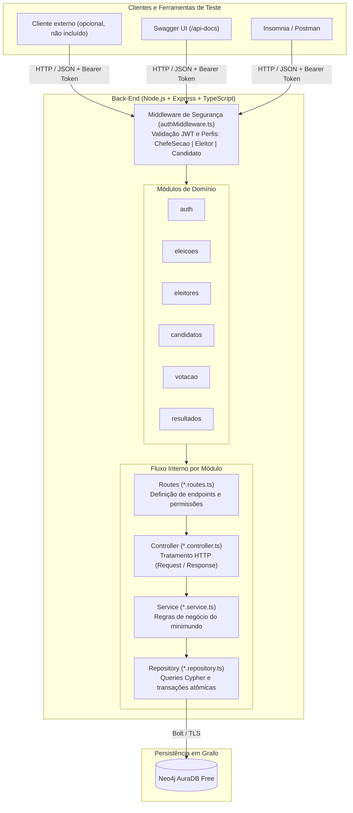
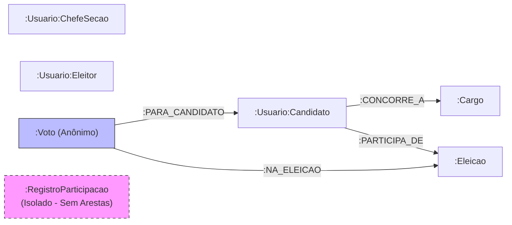

# 🗳️ Sistema de Simulação de Eleição Eletrônica - Back-End

API RESTful desenvolvida em **Node.js**, **TypeScript** e **Neo4j (Banco de Dados Orientado a Grafos)** para simular o ciclo completo de uma eleição eletrônica: administração do pleito, cadastro de participantes, votação com separação dos dados de participação e de voto, acompanhamento em tempo real e apuração final dos resultados.

---

## 🛠️ Tecnologias Utilizadas

* **Runtime & Linguagem:** Node.js + TypeScript 5
* **Framework Web:** Express 5
* **Banco de Dados:** Neo4j AuraDB Free + `neo4j-driver`
* **Autenticação & Segurança:** JSON Web Token (`jsonwebtoken`) e hash de senhas com `bcryptjs`
* **Documentação Interativa:** OpenAPI 3.0 com Swagger UI (`swagger-ui-express`)
* **Testes Automatizados:** Jest (`ts-jest`) e Supertest

---

## 1. Arquitetura do Sistema

A aplicação adota uma **Arquitetura em Camadas Orientada a Domínio (Modular Layered Architecture)**, separando responsabilidades técnicas e de negócio para facilitar manutenção, testabilidade e evolução do código:



### Decisões Arquiteturais Relevantes
1. **Separação entre `app.ts` e `server.ts`:** A configuração do Express (rotas, middlewares e Swagger) fica isolada em `src/app.ts`, enquanto a conexão com o banco, execução do *seed* e abertura da porta HTTP ficam em `src/server.ts`. Isso permite que os testes de integração importem a aplicação sem precisar abrir portas de rede.
2. **Controle de Acesso Baseado em Perfis (RBAC):** Implementado via middleware (`authMiddleware.ts`), que verifica a assinatura do JWT, confirma a existência e o estado ativo do usuário no banco e valida se o perfil autenticado (`ChefeSecao`, `Eleitor` ou `Candidato`) possui autorização para acessar o recurso solicitado.
3. **Constraints automáticas:** O servidor cria as seis restrições de unicidade antes de aceitar requisições.
4. **Seed Automático Idempotente (`src/config/seed.ts`):** Ao iniciar, o servidor garante a existência dos 5 cargos oficiais e do usuário administrador inicial (`ChefeSecao`) utilizando operações `MERGE` no Neo4j.

---

## 2. Descrição da Modularização

O código-fonte dentro de `backend/` está dividido em módulos funcionais independentes, onde cada módulo encapsula suas próprias rotas, controlador, serviço e repositório:

```text
backend/
├── database/
│   ├── init.cypher                 # Script de constraints e cargos
│   └── migracao-sigilo.cypher      # Remoção opcional de horários antigos
├── src/
│   ├── config/
│   │   ├── neo4j.ts                # Conexão e gerenciamento de sessões com AuraDB
│   │   ├── constraints.ts          # Restrições de unicidade
│   │   ├── env.ts                  # Validação da chave JWT
│   │   ├── seed.ts                 # Inicialização automática de cargos e Chefe da Seção
│   │   └── swagger.ts              # Especificação OpenAPI 3.0 e configuração do Swagger UI
│   ├── shared/
│   │   ├── errors.ts                # Erros de domínio e mapeamento HTTP padronizado
│   │   ├── validacao.ts             # Validação de entradas e cargos oficiais
│   │   ├── transacoes.ts            # Locks transacionais compartilhados
│   │   └── middlewares/
│   │       ├── authMiddleware.ts   # Autenticação JWT e autorização por perfil
│   │       └── errorHandler.ts     # Tratamento global de 404 e JSON inválido
│   ├── modules/
│   │   ├── auth/                   # Módulo 1: Login e emissão de token JWT
│   │   ├── eleicoes/               # Módulo 2: Cadastro, abertura, encerramento e status
│   │   ├── eleitores/              # Módulo 3: CRUD completo de eleitores
│   │   ├── candidatos/             # Módulo 4: CRUD de candidatos e vínculo com cargo/eleição
│   │   ├── votacao/                # Módulo 5: Registro sigiloso de voto e trava anti-duplicidade
│   │   └── resultados/             # Módulos 6 e 7: Acompanhamento parcial e apuração final
│   ├── app.ts                      # Instância configurada do Express
│   └── server.ts                   # Ponto de entrada (bootstrap do servidor)
└── tests/
    ├── unit/
    │   ├── regras-negocio.test.ts        # Testes unitários das regras de negócio
    │   ├── validacao-e-cadastros.test.ts # Testes unitários de validação, auth e cadastros
    │   └── transacoes.test.ts            # Testes unitários de repositórios com mocks
    └── integration/
        ├── api.test.ts                   # Integração HTTP com banco simulado
        └── neo4j.test.ts                 # Integração HTTP com Neo4j real (opt-in)
```

### Responsabilidade de Cada Módulo
* **`auth`:** Autentica `ChefeSecao`, `Eleitor` e `Candidato` por e-mail e senha (`bcryptjs`), gerando um token JWT contendo o perfil do usuário.
* **`eleicoes`:** Permite ao Chefe da Seção cadastrar eleições (data, turno, horários) e gerenciar suas transições de estado (`AGENDADA` → `ABERTA` → `ENCERRADA`), além de permitir consulta da situação atual.
* **`eleitores`:** CRUD restrito ao Chefe da Seção. A exclusão lógica desativa o eleitor, remove a senha e preserva o histórico de participação.
* **`candidatos`:** CRUD restrito ao Chefe da Seção para cadastrar candidatos com número eleitoral e partido, criando no grafo os vínculos com `:Cargo` e `:Eleicao`. Cadastro, alteração e exclusão somente em eleições AGENDADAS. Também expõe listagem filtrável para os eleitores.
* **`votacao`:** Exclusivo para o perfil `Eleitor`. Valida se a eleição está `ABERTA`, registra o voto de forma sigilosa e impede votos duplicados para o mesmo cargo ou alterações posteriores.
* **`resultados`:** Gerencia o acompanhamento em tempo real (aplicando filtro automático para exibir ao `Candidato` apenas o cargo ao qual concorre) e a apuração do resultado final com o candidato mais votado após o encerramento.

---

## 3. Modelagem do Banco de Dados (Neo4j — Grafo)

Optou-se pelo **Neo4j** por sua capacidade nativa de expressar relacionamentos entre candidatos, cargos e eleições, além de permitir isolar fisicamente o nó de voto anônimo do nó do eleitor.

### Diagrama do Grafo



### Descrição dos Nós (Labels e Propriedades)

| Rótulo (Label) | Propriedades Principais | Descrição |
| :--- | :--- | :--- |
| **`:Usuario:ChefeSecao`** | `id` (UUID), `nome`, `email`, `senhaHash` | Administrador responsável por gerenciar eleições, eleitores e candidatos. |
| **`:Usuario:Eleitor`** | `id` (UUID), `nome`, `email`, `senhaHash`, `tituloEleitor`, `ativo` | Usuário habilitado a votar uma vez por cargo quando a eleição está `ABERTA`. |
| **`:Usuario:Candidato`** | `id` (UUID), `nome`, `email`, `senhaHash`, `numeroEleitoral`, `partido` | Usuário que concorre a um cargo específico em uma eleição. |
| **`:Eleicao`** | `id` (UUID), `data`, `turno`, `horarioAbertura`, `horarioEncerramento`, `status` | Representa o pleito (`AGENDADA`, `ABERTA` ou `ENCERRADA`). |
| **`:Cargo`** | `nome` | Os 5 cargos fixos: *Deputado Estadual*, *Deputado Federal*, *Senador*, *Governador* e *Presidente da República*. |
| **`:Voto`** | `id` (UUID) | Voto anônimo contabilizado na apuração. Não possui referência ao eleitor. |
| **`:RegistroParticipacao`** | `chaveUnica` | Nó isolado com chave composta (`${eleitorId}_${eleicaoId}_${cargo}`) para controle de voto único. |

### Descrição dos Relacionamentos

* `(:Candidato)-[:CONCORRE_A]->(:Cargo)`: Define a qual dos cinco cargos oficiais o candidato concorre.
* `(:Candidato)-[:PARTICIPA_DE]->(:Eleicao)`: Vincula o candidato a uma eleição específica.
* `(:Voto)-[:PARA_CANDIDATO]->(:Candidato)`: Contabiliza o voto para o candidato escolhido.
* `(:Voto)-[:NA_ELEICAO]->(:Eleicao)`: Associa o voto à eleição correspondente.

### Garantia de Sigilo e Restrições de Integridade (`database/init.cypher`)
Para atender simultaneamente à **unicidade do voto por cargo** e à **separação de identidade e escolha**, o sistema não cria nenhuma aresta entre `:Eleitor` e `:Voto`. Durante a confirmação do voto, uma transação atômica cria:
1. Um nó `:RegistroParticipacao` com `chaveUnica = "${eleitorId}_${eleicaoId}_${cargo}"`, protegido por uma *Unique Constraint* no Neo4j. Se o eleitor tentar votar novamente no mesmo cargo, o banco rejeita a transação.
2. Um nó anônimo `:Voto` ligado apenas ao candidato e à eleição. Não são gravados horários individuais nem devolvido o ID do voto. A API não oferece consulta por eleitor.

A eleição é bloqueada para escrita antes de validar o estado dentro da mesma transação do voto. Abertura, encerramento e alterações de candidatos usam a mesma trava; o eleitor também é bloqueado durante o voto para sincronizar sua exclusão. As operações de cadastro e alteração dos candidatos verificam o número eleitoral dentro da transação. O bloqueio é implementado com propriedade temporária, conforme [documentação do Neo4j](https://neo4j.com/docs/operations-manual/current/database-internals/concurrent-data-access/).

**Limite do sigilo:** este é um simulador acadêmico, não uma urna de produção. A contagem exata em tempo real, logs administrativos, observação de requisições e dados históricos podem permitir inferências. Não há garantia de anonimato criptográfico absoluto.

Restrições aplicadas automaticamente no banco:
* `usuario_id_unico` (`:Usuario.id`) e `usuario_email_unico` (`:Usuario.email`)
* `eleicao_id_unico` (`:Eleicao.id`)
* `cargo_nome_unico` (`:Cargo.nome`)
* `voto_id_unico` (`:Voto.id`)
* `participacao_unica` (`:RegistroParticipacao.chaveUnica`)

---

## 4. Matriz de Regras de Negócio e Perfis

| Funcionalidade / Regra | Chefe da Seção | Eleitor | Candidato |
| :--- | :---: | :---: | :---: |
| Login com credenciais (JWT) | ✅ | ✅ | ✅ |
| Cadastrar / Abrir / Encerrar Eleição | ✅ | ❌ | ❌ |
| Consultar situação da Eleição | ✅ | ✅ | ✅ |
| Cadastrar / Alterar / Consultar / Excluir Eleitores | ✅ | ❌ | ❌ |
| Cadastrar / Alterar / Consultar / Excluir Candidatos | ✅ | ❌ | ❌ |
| Listar candidatos disponíveis | ✅ | ✅ | ✅ |
| Votar (apenas com eleição `ABERTA`, 1x por cargo, imutável) | ❌ | ✅ | ❌ |
| Acompanhar votação em tempo real | Todos os cargos | Todos os cargos | Apenas seu próprio cargo |
| Consultar resultado final (apenas com eleição `ENCERRADA`) | ✅ | ✅ | ✅ |

---

## 5. Como Executar o Projeto

### Pré-requisitos
* Node.js 22 ou superior (confira também os requisitos das dependências do `package-lock.json`).
* Uma instância Neo4j AuraDB ou Neo4j local, com permissão para criar constraints.

### Passo a passo (Windows / PowerShell)
1. Extraia o projeto ou clone seu repositório Git e abra a pasta `backend` no terminal.
2. Instale as dependências e copie o modelo de configuração:
   ```powershell
   npm ci
   Copy-Item .env.example .env
   ```
3. Gere uma chave JWT e preencha o `.env`:
   ```powershell
   node -e "console.log(require('crypto').randomBytes(32).toString('hex'))"
   ```
   Informe a chave gerada em `JWT_SECRET`, os dados da sua instância Neo4j em `NEO4J_URI`, `NEO4J_USERNAME`, `NEO4J_PASSWORD`, e o e-mail e senha do administrador em `CHEFE_EMAIL`, `CHEFE_SENHA`. A senha deve ter pelo menos 8 caracteres (máximo 72 bytes). Não publique o `.env`. O seed usa a senha configurada a cada inicialização.
4. Compile e inicie:
   ```powershell
   npm run build
   npm run dev
   ```
   O servidor verifica o banco e cria automaticamente as constraints, os cinco cargos e o Chefe da Seção. O script `database/init.cypher` continua disponível para execução manual, mas não é necessário em um banco novo.

---

## 6. Documentação da API (Swagger UI)

Acesse a documentação interativa no navegador:
* **Swagger público (Render):** [https://simulacao-de-eleicao-eletronica.onrender.com/api-docs/](https://simulacao-de-eleicao-eletronica.onrender.com/api-docs/)
* **Swagger local (com o servidor em execução):** `http://localhost:3000/api-docs`
* **Especificação OpenAPI JSON (importação no Postman/Insomnia):** `http://localhost:3000/api-docs.json`
* **Repositório:** [GitHub — Simulação de Eleição Eletrônica](https://github.com/prg95/Simulacao-de-Eleicao-Eletronica)

A especificação OpenAPI utiliza `servers: [{ url: '/' }]`, permitindo que as requisições sejam enviadas à origem atual da documentação, tanto localmente quanto na hospedagem.

### Como testar rotas protegidas no Swagger:
1. Execute o endpoint `POST /auth/login` com as credenciais do Chefe da Seção (e-mail e senha definidos no `.env`) ou de um usuário cadastrado.
2. Copie o valor do campo `token` retornado.
3. Clique no botão **Authorize** no topo direito da página do Swagger, cole o token e clique em **Authorize**.

### Resumo dos Endpoints

| Método | Rota | Perfil Autorizado | Descrição |
| :--- | :--- | :--- | :--- |
| `GET` | `/health` | Público | Verifica disponibilidade da API |
| `POST` | `/auth/login` | Público | Autentica usuário e retorna token JWT |
| `POST` | `/eleicoes` | `ChefeSecao` | Cadastra nova eleição (status `AGENDADA`) |
| `GET` | `/eleicoes` | Todos autenticados | Lista todas as eleições |
| `GET` | `/eleicoes/:id` | Todos autenticados | Consulta a situação atual de uma eleição |
| `PATCH` | `/eleicoes/:id/abrir` | `ChefeSecao` | Altera status de `AGENDADA` para `ABERTA` |
| `PATCH` | `/eleicoes/:id/encerrar` | `ChefeSecao` | Altera status de `ABERTA` para `ENCERRADA` |
| `POST/GET/PUT/DELETE` | `/eleitores` | `ChefeSecao` | Gerenciamento completo de eleitores |
| `POST/PUT/DELETE` | `/candidatos` | `ChefeSecao` | Gerenciamento de candidatos e vínculos |
| `GET` | `/candidatos` | Todos autenticados | Lista candidatos (filtros: `eleicaoId`, `cargo`) |
| `POST` | `/votacao` | `Eleitor` | Registra e confirma voto sigiloso |
| `GET` | `/votacao/meus-status/:eleicaoId` | `Eleitor` | Lista cargos votados e pendentes |
| `GET` | `/resultados/:eleicaoId/acompanhamento` | Todos autenticados | Contabilização parcial (filtrada para `Candidato`) |
| `GET` | `/resultados/:eleicaoId/final` | Todos autenticados | Apuração final e vencedor por cargo (`ENCERRADA`) |

---

## 7. Testes Automatizados

| Arquivo | Tipo | Escopo |
|---|---|---|
| `tests/unit/regras-negocio.test.ts` | Unitário | Validação dos serviços de votação, eleições e apuração de resultados |
| `tests/unit/validacao-e-cadastros.test.ts` | Unitário | Validação de entradas, cargos oficiais, autenticação, eleitores e candidatos |
| `tests/unit/transacoes.test.ts` | Unitário | Repositórios com driver simulado: locks, validação antes da gravação, duplicidade, exclusão e transferência de candidatos |
| `tests/integration/api.test.ts` | Integração HTTP | Express, OpenAPI JSON, tratamento global de erros, JWT e perfis com banco simulado |
| `tests/integration/neo4j.test.ts` | Integração real | Login, CRUD, concorrência, votação, sigilo estrutural e apuração usando o banco |

### Execução padrão (sem banco)
```powershell
npm test -- --runInBand
```
O teste com Neo4j real fica marcado como `skipped` por padrão. Os testes unitários e HTTP não precisam de uma conexão de banco.

### Execução com Neo4j real
Configure o `.env` para uma instância **separada de testes**. Em PowerShell:
```powershell
$env:RUN_NEO4J_TESTS = '1'
npm test -- --runInBand
Remove-Item Env:RUN_NEO4J_TESTS
```
A suíte de integração cria dados identificados exclusivamente para o teste e tenta removê-los ao final. Também garante a criação de constraints e dos cargos.

### Resultados da validação

A execução dos testes unitários e de integração HTTP (sem banco externo) e a compilação TypeScript foram validadas após as melhorias de validação, tratamento de erros e documentação OpenAPI:

| Verificação | Resultado |
|---|---|
| Suítes unitárias e de integração HTTP (`npm test -- --runInBand`) | 4 suítes aprovadas (60 testes aprovados; 1 suíte Neo4j real ignorada por padrão) |
| Compilação TypeScript (`npm run build`) | Concluída sem erros |

*(Validação anterior em ambiente com Neo4j AuraDB ativo e deploy no Render: suíte real com Neo4j aprovada na versão base, testes funcionais manuais pelo Swagger e execução de `node dist/src/server.js` validados.)*

Os testes manuais abrangeram autenticação dos três perfis, CRUD de eleitores e candidatos, validações de cadastro, abertura e encerramento da eleição, votação nos cinco cargos, bloqueio de votos duplicados e fora do período de votação (conforme o estado da eleição), acompanhamento por perfil, consulta do resultado final e bloqueio de acesso sem autenticação. A contagem observada durante a simulação foi de cinco votos válidos, um por cargo.

---

## 8. Hospedagem

A API está hospedada no **Render**, utilizando o **Neo4j AuraDB** como banco de dados na nuvem.

| Configuração | Valor |
|---|---|
| Plataforma | Render (Web Service, plano gratuito) |
| Runtime | Node.js |
| Branch | `main` |
| Root Directory | `backend` |
| Build Command | `npm ci --include=dev && npm run build` |
| Start Command | `node dist/src/server.js` |
| Documentação pública | [Swagger UI](https://simulacao-de-eleicao-eletronica.onrender.com/api-docs/) |

