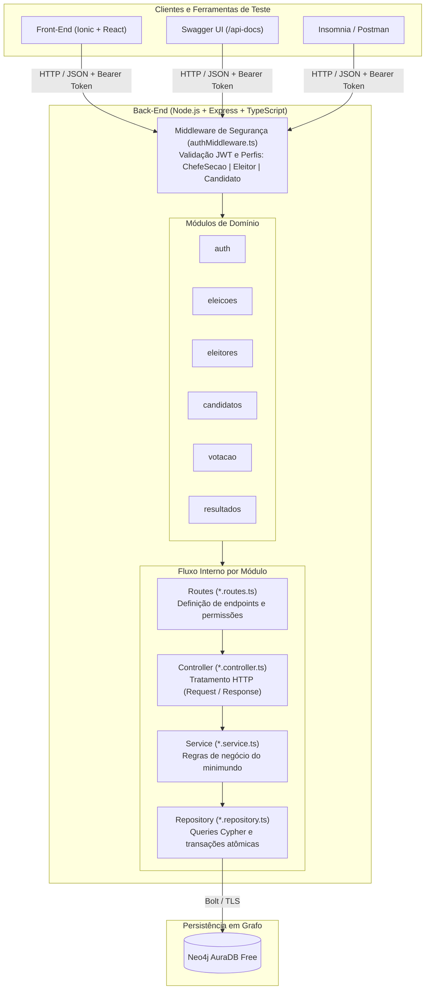
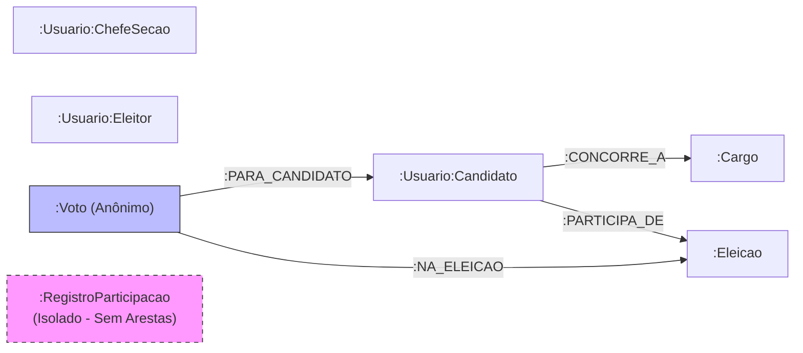

# 🗳️ Sistema de Simulação de Eleição Eletrônica - Back-End

API RESTful desenvolvida em **Node.js**, **TypeScript** e **Neo4j (Banco de Dados Orientado a Grafos)** para simular o ciclo completo de uma eleição eletrônica: administração do pleito, cadastro de participantes, votação com sigilo garantido, acompanhamento em tempo real e apuração final dos resultados.

---

## 🛠️ Tecnologias Utilizadas

* **Runtime & Linguagem:** Node.js + TypeScript 5
* **Framework Web:** Express 5
* **Banco de Dados:** Neo4j AuraDB Free + `neo4j-driver`
* **Autenticação & Segurança:** JSON Web Token (`jsonwebtoken`) e hash de senhas com `bcryptjs`
* **Documentação Interativa:** OpenAPI 3.0 com Swagger UI (`swagger-ui-express`)
* **Testes Automatizados:** Jest (`ts-jest`) e Supertest

---

## 1. Arquitetura do Sistema

A aplicação adota uma **Arquitetura em Camadas Orientada a Domínio (Modular Layered Architecture)**, separando responsabilidades técnicas e de negócio para facilitar manutenção, testabilidade e evolução do código:



### Decisões Arquiteturais Relevantes
1. **Separação entre `app.ts` e `server.ts`:** A configuração do Express (rotas, middlewares e Swagger) fica isolada em `src/app.ts`, enquanto a conexão com o banco, execução do *seed* e abertura da porta HTTP ficam em `src/server.ts`. Isso permite que os testes de integração importem a aplicação sem precisar abrir portas de rede.
2. **Controle de Acesso Baseado em Perfis (RBAC):** Implementado via middleware (`authMiddleware.ts`), que decodifica o JWT e valida se o perfil autenticado (`ChefeSecao`, `Eleitor` ou `Candidato`) possui autorização para acessar o recurso solicitado.
3. **Seed Automático Idempotente (`src/config/seed.ts`):** Ao iniciar, o servidor garante a existência dos 5 cargos oficiais e do usuário administrador inicial (`ChefeSecao`) utilizando operações `MERGE` no Neo4j.

---

## 2. Descrição da Modularização

O código-fonte dentro de `backend/` está dividido em módulos funcionais independentes, onde cada módulo encapsula suas próprias rotas, controlador, serviço e repositório:

```text
backend/
├── database/
│   └── init.cypher                 # Script de constraints e carga inicial do Neo4j
├── src/
│   ├── config/
│   │   ├── neo4j.ts                # Conexão e gerenciamento de sessões com AuraDB
│   │   ├── seed.ts                 # Inicialização automática de cargos e Chefe da Seção
│   │   └── swagger.ts              # Especificação OpenAPI 3.0 e configuração do Swagger UI
│   ├── shared/
│   │   └── middlewares/
│   │       └── authMiddleware.ts   # Autenticação JWT e autorização por perfil
│   ├── modules/
│   │   ├── auth/                   # Módulo 1: Login e emissão de token JWT
│   │   ├── eleicoes/               # Módulo 2: Cadastro, abertura, encerramento e status
│   │   ├── eleitores/              # Módulo 3: CRUD completo de eleitores
│   │   ├── candidatos/             # Módulo 4: CRUD de candidatos e vínculo com cargo/eleição
│   │   ├── votacao/                # Módulo 5: Registro sigiloso de voto e trava anti-duplicidade
│   │   └── resultados/             # Módulos 6 e 7: Acompanhamento parcial e apuração final
│   ├── app.ts                      # Instância configurada do Express
│   └── server.ts                   # Ponto de entrada (bootstrap do servidor)
└── tests/
    ├── unit/
    │   └── regras-negocio.test.ts  # Testes unitários isolados das camadas Service
    └── integration/
        └── api.test.ts             # Testes de integração HTTP (rotas, JWT e perfis)
```

### Responsabilidade de Cada Módulo
* **`auth`:** Autentica `ChefeSecao`, `Eleitor` e `Candidato` por e-mail e senha (`bcryptjs`), gerando um token JWT contendo o perfil do usuário.
* **`eleicoes`:** Permite ao Chefe da Seção cadastrar eleições (data, turno, horários) e gerenciar suas transições de estado (`AGENDADA` → `ABERTA` → `ENCERRADA`), além de permitir consulta da situação atual.
* **`eleitores`:** CRUD completo restrito ao Chefe da Seção para gerenciar os eleitores aptos a votar.
* **`candidatos`:** CRUD restrito ao Chefe da Seção para cadastrar candidatos com número eleitoral e partido, criando no grafo os vínculos com `:Cargo` e `:Eleicao`. Também expõe listagem filtrável para os eleitores.
* **`votacao`:** Exclusivo para o perfil `Eleitor`. Valida se a eleição está `ABERTA`, registra o voto de forma sigilosa e impede votos duplicados para o mesmo cargo ou alterações posteriores.
* **`resultados`:** Gerencia o acompanhamento em tempo real (aplicando filtro automático para exibir ao `Candidato` apenas o cargo ao qual concorre) e a apuração do resultado final com o candidato mais votado após o encerramento.

---

## 3. Modelagem do Banco de Dados (Neo4j — Grafo)

Optou-se pelo **Neo4j** por sua capacidade nativa de expressar relacionamentos entre candidatos, cargos e eleições, além de permitir isolar fisicamente o nó de voto anônimo do nó do eleitor.

### Diagrama do Grafo



### Descrição dos Nós (Labels e Propriedades)

| Rótulo (Label) | Propriedades Principais | Descrição |
| :--- | :--- | :--- |
| **`:Usuario:ChefeSecao`** | `id` (UUID), `nome`, `email`, `senhaHash` | Administrador responsável por gerenciar eleições, eleitores e candidatos. |
| **`:Usuario:Eleitor`** | `id` (UUID), `nome`, `email`, `senhaHash`, `tituloEleitor` | Usuário habilitado a votar uma vez por cargo quando a eleição está `ABERTA`. |
| **`:Usuario:Candidato`** | `id` (UUID), `nome`, `email`, `senhaHash`, `numeroEleitoral`, `partido` | Usuário que concorre a um cargo específico em uma eleição. |
| **`:Eleicao`** | `id` (UUID), `data`, `turno`, `horarioAbertura`, `horarioEncerramento`, `status` | Representa o pleito (`AGENDADA`, `ABERTA` ou `ENCERRADA`). |
| **`:Cargo`** | `nome` | Os 5 cargos fixos: *Deputado Estadual*, *Deputado Federal*, *Senador*, *Governador* e *Presidente da República*. |
| **`:Voto`** | `id` (UUID), `confirmadoEm` | Voto anônimo contabilizado na apuração. Não possui referência ao eleitor. |
| **`:RegistroParticipacao`** | `chaveUnica`, `registradoEm` | Nó isolado com chave composta (`${eleitorId}_${eleicaoId}_${cargo}`) para controle de voto único. |

### Descrição dos Relacionamentos

* `(:Candidato)-[:CONCORRE_A]->(:Cargo)`: Define a qual dos cinco cargos oficiais o candidato concorre.
* `(:Candidato)-[:PARTICIPA_DE]->(:Eleicao)`: Vincula o candidato a uma eleição específica.
* `(:Voto)-[:PARA_CANDIDATO]->(:Candidato)`: Contabiliza o voto para o candidato escolhido.
* `(:Voto)-[:NA_ELEICAO]->(:Eleicao)`: Associa o voto à eleição correspondente.

### Garantia de Sigilo e Restrições de Integridade (`database/init.cypher`)
Para atender simultaneamente à **unicidade do voto por cargo** e ao **sigilo absoluto**, o sistema não cria nenhuma aresta entre `:Eleitor` e `:Voto`. Durante a confirmação do voto, uma transação atômica cria:
1. Um nó `:RegistroParticipacao` com `chaveUnica = "${eleitorId}_${eleicaoId}_${cargo}"`, protegido por uma *Unique Constraint* no Neo4j. Se o eleitor tentar votar novamente no mesmo cargo, o banco rejeita a transação.
2. Um nó anônimo `:Voto` ligado apenas ao candidato e à eleição, impossibilitando rastrear em quem o eleitor votou.

Restrições aplicadas no banco:
* `usuario_id_unico` (`:Usuario.id`) e `usuario_email_unico` (`:Usuario.email`)
* `eleicao_id_unico` (`:Eleicao.id`)
* `cargo_nome_unico` (`:Cargo.nome`)
* `voto_id_unico` (`:Voto.id`)
* `participacao_unica` (`:RegistroParticipacao.chaveUnica`)

---

## 4. Matriz de Regras de Negócio e Perfis

| Funcionalidade / Regra | Chefe da Seção | Eleitor | Candidato |
| :--- | :---: | :---: | :---: |
| Login com credenciais (JWT) | ✅ | ✅ | ✅ |
| Cadastrar / Abrir / Encerrar Eleição | ✅ | ❌ | ❌ |
| Consultar situação da Eleição | ✅ | ✅ | ✅ |
| Cadastrar / Alterar / Consultar / Excluir Eleitores | ✅ | ❌ | ❌ |
| Cadastrar / Alterar / Consultar / Excluir Candidatos | ✅ | ❌ | ❌ |
| Listar candidatos disponíveis | ✅ | ✅ | ✅ |
| Votar (apenas com eleição `ABERTA`, 1x por cargo, imutável) | ❌ | ✅ | ❌ |
| Acompanhar votação em tempo real | Todos os cargos | Todos os cargos | Apenas seu próprio cargo |
| Consultar resultado final (apenas com eleição `ENCERRADA`) | ✅ | ✅ | ✅ |

---

## 5. Como Executar o Projeto

### Pré-requisitos
* Node.js (v18 ou superior)
* Uma instância gratuita do **Neo4j AuraDB Free** (ou Neo4j local)

### Passo a Passo
1. **Clone o repositório e acesse a pasta do Back-End:**
   ```bash
   git clone <URL_DO_SEU_REPOSITORIO>
   cd Simulacao-de-Eleicao-Eletronica/backend
   ```

2. **Instale as dependências:**
   ```bash
   npm install
   ```

3. **Configure as variáveis de ambiente:**
   Crie um arquivo `.env` na raiz de `backend/` baseado no exemplo abaixo:
   ```env
   PORT=3000
   JWT_SECRET="chave_secreta_eleicao_2026"
   NEO4J_URI="neo4j+s://SEU_ID.databases.neo4j.io"
   NEO4J_USERNAME="neo4j"
   NEO4J_PASSWORD="SUA_SENHA_DO_AURADB"
   CHEFE_EMAIL="chefe@eleicao.gov.br"
   CHEFE_SENHA="admin123"
   ```

4. **Configure as constraints no Neo4j:**
   Execute o conteúdo do arquivo `backend/database/init.cypher` no console **Query** do seu Neo4j AuraDB.

5. **Inicie o servidor em modo de desenvolvimento:**
   ```bash
   npm run dev
   ```
   O servidor iniciará em `http://localhost:3000` e criará automaticamente os cargos e o Chefe da Seção inicial.

---

## 6. Documentação da API (Swagger UI)

Com o servidor em execução, acesse a documentação interativa no navegador:
* **URL:** `http://localhost:3000/api-docs`

### Como testar rotas protegidas no Swagger:
1. Execute o endpoint `POST /auth/login` com as credenciais do Chefe da Seção (`chefe@eleicao.gov.br` / `admin123`) ou de um usuário cadastrado.
2. Copie o valor do campo `token` retornado.
3. Clique no botão **Authorize** no topo direito da página do Swagger, cole o token e clique em **Authorize**.

### Resumo dos Endpoints

| Método | Rota | Perfil Autorizado | Descrição |
| :--- | :--- | :--- | :--- |
| `POST` | `/auth/login` | Público | Autentica usuário e retorna token JWT |
| `POST` | `/eleicoes` | `ChefeSecao` | Cadastra nova eleição (status `AGENDADA`) |
| `GET` | `/eleicoes` | Todos autenticados | Lista todas as eleições |
| `GET` | `/eleicoes/:id` | Todos autenticados | Consulta a situação atual de uma eleição |
| `PATCH` | `/eleicoes/:id/abrir` | `ChefeSecao` | Altera status de `AGENDADA` para `ABERTA` |
| `PATCH` | `/eleicoes/:id/encerrar` | `ChefeSecao` | Altera status de `ABERTA` para `ENCERRADA` |
| `POST/GET/PUT/DELETE` | `/eleitores` | `ChefeSecao` | Gerenciamento completo de eleitores |
| `POST/PUT/DELETE` | `/candidatos` | `ChefeSecao` | Gerenciamento de candidatos e vínculos |
| `GET` | `/candidatos` | Todos autenticados | Lista candidatos (filtros: `eleicaoId`, `cargo`) |
| `POST` | `/votacao` | `Eleitor` | Registra e confirma voto sigiloso |
| `GET` | `/votacao/meus-status/:eleicaoId` | `Eleitor` | Lista cargos em que o eleitor já votou |
| `GET` | `/resultados/:eleicaoId/acompanhamento` | Todos autenticados | Contabilização parcial (filtrada para `Candidato`) |
| `GET` | `/resultados/:eleicaoId/final` | Todos autenticados | Apuração final e vencedor por cargo (`ENCERRADA`) |

---

## 7. Testes Automatizados

A suíte de testes foi desenvolvida com **Jest (`ts-jest`)** e **Supertest**, dividida em duas camadas distintas dentro de `backend/tests/` para separar a validação isolada das regras de negócio da validação dos fluxos HTTP e de segurança:

```text
backend/tests/
├── unit/
│   └── regras-negocio.test.ts   # 6 testes unitários (camada Service com mocks)
└── integration/
    └── api.test.ts              # 4 testes de integração (rotas HTTP, JWT e RBAC)
```

---

### 7.1 Testes Unitários (`tests/unit/regras-negocio.test.ts`)

Os testes unitários validam exclusivamente as regras de negócio contidas nas classes `*Service`, simulando (*mockando*) os repositórios (`*Repository`) para executar de forma rápida e determinística sem depender de rede ou conexão ativa com o Neo4j:

#### `VotacaoService`
1. **Bloqueio de voto fora do período de votação (`deve impedir voto quando a eleição não estiver ABERTA`):**
   * **Cenário:** Simula uma eleição com status `AGENDADA` no banco.
   * **Validação:** Garante que o método `confirmarVoto` lança uma exceção (`"Votação não permitida. A eleição está atualmente AGENDADA."`) e confirma que o método de gravação no banco (`registrarVotoSigiloso`) **não** é chamado.
2. **Prevenção de voto duplicado por cargo (`deve impedir voto duplicado do mesmo eleitor para o mesmo cargo`):**
   * **Cenário:** Simula a falha de unicidade do Neo4j (`Neo.ClientError.Schema.ConstraintValidationFailed`) disparada pela chave composta de `:RegistroParticipacao` (`eleitorId_eleicaoId_cargo`).
   * **Validação:** Garante que o serviço intercepta o erro técnico do banco e retorna uma mensagem clara ao eleitor impedindo um segundo voto para o mesmo cargo naquela eleição.

#### `ResultadosService`
3. **Restrição de acompanhamento por cargo para Candidatos (`deve restringir o acompanhamento do Candidato apenas ao seu próprio cargo`):**
   * **Cenário:** Um usuário autenticado com perfil `Candidato` (concorrendo a *Governador*) solicita o acompanhamento parcial da votação.
   * **Validação:** Verifica se o serviço consulta o cargo do candidato e repassa obrigatoriamente o filtro `'Governador'` ao repositório (`contabilizarVotos('eleicao-1', 'Governador')`), ocultando os resultados dos demais cargos.
4. **Bloqueio do resultado final antes do encerramento (`deve bloquear consulta do resultado final enquanto a eleição estiver ABERTA`):**
   * **Cenário:** Solicitação de apuração final enquanto o status da eleição ainda é `ABERTA`.
   * **Validação:** Garante que o serviço bloqueia a operação e informa que o resultado final só fica disponível após o encerramento da votação.
5. **Apuração e identificação do vencedor após encerramento (`deve apontar o candidato mais votado por cargo quando a eleição estiver ENCERRADA`):**
   * **Cenário:** Simula uma eleição com status `ENCERRADA` e dois candidatos disputando *Presidente da República* (42 votos contra 30 votos).
   * **Validação:** Confirma que o serviço agrupa os candidatos por cargo e identifica corretamente o candidato com maior número de votos no campo `maisVotado`.

#### `EleicoesService`
6. **Validação do ciclo de vida da eleição (`deve impedir encerrar uma eleição que ainda está AGENDADA`):**
   * **Cenário:** Tentativa de chamar `encerrarVotacao` em uma eleição que ainda não foi aberta (`status: 'AGENDADA'`).
   * **Validação:** Garante que a transição inválida é bloqueada, exigindo que a eleição passe primeiro pelo estado `ABERTA`.

---

### 7.2 Testes de Integração (`tests/integration/api.test.ts`)

Os testes de integração utilizam o **Supertest** para disparar requisições HTTP reais contra a instância do Express (`src/app.ts`), validando o encadeamento entre rotas, middlewares de autenticação JWT, controle de acesso por perfil (RBAC) e respostas HTTP:

1. **Verificação de disponibilidade da API (`GET /health deve retornar status 200`):**
   * **Cenário:** Requisição `GET` para a rota pública `/health`.
   * **Validação:** Confirma que o servidor Express está ativo e respondendo corretamente em JSON (`status: "OK"`).
2. **Bloqueio de acesso não autenticado (`POST /eleicoes sem token JWT deve retornar 401`):**
   * **Cenário:** Requisição `POST /eleicoes` enviada sem o cabeçalho `Authorization: Bearer <token>`.
   * **Validação:** Confirma que o middleware `autenticarJWT` intercepta a chamada e retorna HTTP `401 Unauthorized`.
3. **Controle de perfil na criação de eleição (`POST /eleicoes com perfil Eleitor deve retornar 403`):**
   * **Cenário:** Requisição `POST /eleicoes` autenticada com um token JWT válido pertencente ao perfil `Eleitor`.
   * **Validação:** Confirma que o middleware `exigirPerfil('ChefeSecao')` bloqueia a ação e retorna HTTP `403 Forbidden`, garantindo que apenas o Chefe da Seção administre eleições.
4. **Controle de perfil na votação (`POST /votacao com perfil ChefeSecao deve retornar 403`):**
   * **Cenário:** Requisição `POST /votacao` autenticada com um token JWT pertencente ao perfil `ChefeSecao`.
   * **Validação:** Confirma que o middleware `exigirPerfil('Eleitor')` impede que administradores ou candidatos registrem votos, retornando HTTP `403 Forbidden`.

---

### Como Executar os Testes

Dentro da pasta `backend/`, execute:

```bash
npm test
```

**Saída esperada:**
```text
PASS  tests/unit/regras-negocio.test.ts
PASS  tests/integration/api.test.ts

Test Suites: 2 passed, 2 total
Tests:       10 passed, 10 total
```
