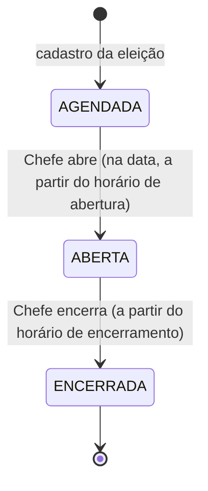
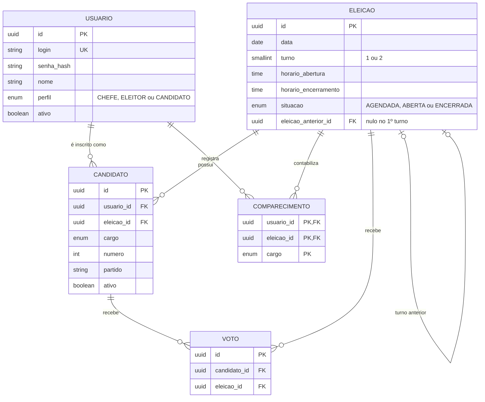

# Sistema de Simulação de Eleição Eletrônica — Back-End

## 1. Visão geral

API para simular uma eleição eletrônica: gerenciamento da eleição, cadastro de eleitores e candidatos, votação sigilosa e acompanhamento dos resultados.

**Stack:** Node.js, NestJS, TypeScript e PostgreSQL.
O Front-End (Ionic/React) é um projeto separado e se comunica com o Back-End apenas pelo contrato da API, documentado com Swagger/OpenAPI.

## 2. Perfis de usuário

| Perfil | O que pode fazer |
|---|---|
| **CHEFE** (Chefe da Seção) | Cadastrar, alterar, consultar e inativar eleitores e candidatos; cadastrar eleição; abrir e encerrar a votação; consultar a situação da eleição |
| **ELEITOR** | Consultar candidatos por cargo; votar; acompanhar a votação de todos os cargos; consultar o resultado final |
| **CANDIDATO** | Votar; acompanhar a votação apenas do cargo em que concorre; consultar o resultado final desse cargo |

Todos os perfis podem votar. As funcionalidades disponíveis respeitam o perfil do usuário autenticado.

## 3. Ciclo de vida da eleição

Somente o Chefe da Seção realiza a abertura e o encerramento. A situação `ABERTA` é a única condição para que votos sejam aceitos.

## 4. Modelo de dados

### 4.1 Diagrama entidade-relacionamento

### 4.2 Dicionário de dados

**USUARIO** — credenciais e identificação de todos os perfis. O eleitor é o próprio usuário.

| Campo | Tipo | Observação |
|---|---|---|
| id | UUID | PK |
| login | texto | único |
| senha_hash | texto | senha armazenada somente como hash |
| nome | texto | |
| perfil | enum | CHEFE, ELEITOR, CANDIDATO |
| ativo | booleano | inativo não autentica nem recebe voto |

**ELEICAO** — uma eleição em um turno. O 2º turno é uma nova eleição ligada à anterior.

| Campo | Tipo | Observação |
|---|---|---|
| id | UUID | PK |
| data | data | dia da votação |
| turno | inteiro | 1 ou 2 |
| horario_abertura | hora | protege a transição para ABERTA |
| horario_encerramento | hora | protege a transição para ENCERRADA |
| situacao | enum | AGENDADA, ABERTA, ENCERRADA |
| eleicao_anterior_id | UUID | FK para ELEICAO; nulo no 1º turno |

Restrição: índice único parcial garante no máximo uma eleição com `situacao = 'ABERTA'`.

**CANDIDATO** — inscrição de um usuário em uma eleição (é a opção de voto).

| Campo | Tipo | Observação |
|---|---|---|
| id | UUID | PK |
| usuario_id | UUID | FK para USUARIO |
| eleicao_id | UUID | FK para ELEICAO |
| cargo | enum | DEPUTADO_ESTADUAL, DEPUTADO_FEDERAL, SENADOR, GOVERNADOR, PRESIDENTE |
| numero | inteiro | número de identificação eleitoral |
| partido | texto | |
| ativo | booleano | |

Restrições: `UNIQUE (eleicao_id, cargo, numero)` e `UNIQUE (id, eleicao_id)` (usada pela chave estrangeira composta de VOTO).

**COMPARECIMENTO** — registra apenas que o usuário já votou em um cargo. Não guarda em quem votou.

| Campo | Tipo | Observação |
|---|---|---|
| usuario_id | UUID | parte da PK; FK para USUARIO |
| eleicao_id | UUID | parte da PK; FK para ELEICAO |
| cargo | enum | parte da PK |

A chave primária composta impede o voto duplicado do mesmo usuário para o mesmo cargo na mesma eleição.

**VOTO** — voto anônimo.

| Campo | Tipo | Observação |
|---|---|---|
| id | UUID | PK aleatória (v4), nunca sequencial |
| candidato_id | UUID | FK composta `(candidato_id, eleicao_id)` para CANDIDATO |
| eleicao_id | UUID | |

Não possui data, hora, usuário nem cargo (o cargo é obtido pelo candidato).

## 5. Regras de negócio

1. **Autenticação:** todos os perfis entram com login e senha; as funcionalidades respeitam o perfil.
2. **Administração:** somente o Chefe cadastra, altera, consulta e inativa eleitores e candidatos, e cadastra, abre e encerra eleições.
3. **Votação:** só é aceita com a eleição `ABERTA`.
4. **Eleição única aberta:** não pode haver mais de uma eleição `ABERTA` ao mesmo tempo.
5. **Abertura e encerramento:** o Chefe só abre na data da eleição e a partir do horário de abertura, e só encerra a partir do horário de encerramento.
6. **Candidatos:** só podem ser cadastrados ou alterados enquanto a eleição estiver `AGENDADA`.
7. **Voto único por cargo:** cada usuário vota uma vez por cargo em cada eleição.
8. **Voto irrevogável:** depois de registrado, o voto não pode ser alterado nem excluído.
9. **Coerência do voto:** o candidato escolhido deve pertencer à eleição e ao cargo informados.
10. **Sigilo do voto:** o sistema controla quem votou em cada cargo, mas não permite descobrir em quem.
11. **Exclusão lógica:** eleitores e candidatos não são excluídos; são marcados como inativos. Os votos já recebidos permanecem na apuração.
12. **Acompanhamento:** o Eleitor acompanha todos os cargos; o Candidato acompanha apenas o cargo em que concorre. A contagem é calculada a partir dos votos e atualizada a cada novo voto.
13. **Resultado final:** disponível após o encerramento, com a quantidade de votos de cada candidato e o candidato mais votado por cargo.
14. **2º turno:** é uma nova eleição (`turno = 2`) com `eleicao_anterior_id` apontando para o 1º turno. O Chefe seleciona, entre os candidatos do turno anterior (que deve estar `ENCERRADO`), quais participam, de qualquer cargo. Os dados do candidato (usuário, cargo, número e partido) são mantidos.

## 6. Decisões de projeto

**Sigilo do voto.** O controle de quem votou (`COMPARECIMENTO`) e o conteúdo do voto (`VOTO`) ficam em estruturas separadas, sem nenhuma ligação entre elas. Para impedir o cruzamento por outros meios, `VOTO` não tem data nem hora, e usa UUID aleatório em vez de ID sequencial (a ordem de inserção não permite casar os registros). O registro do comparecimento e do voto ocorre na mesma transação.

**Sem redundância.** O cargo pertence ao candidato e não é repetido no voto. A quantidade de votos de cada candidato não é armazenada: é calculada por contagem, evitando duas fontes de verdade. A consistência entre voto, candidato e eleição é garantida por chave estrangeira composta.

**Confirmação do voto.** A dupla confirmação acontece na interface. A API recebe um único voto, já confirmado, e o registra de forma irrevogável. O Back-End valida todas as regras por conta própria, sem confiar no cliente.

**Histórico.** Como nenhum registro é excluído e os votos são preservados, o desempenho de cada candidato em cada eleição pode ser consultado a qualquer momento.

## 7. Simplificações assumidas

- O sistema simula uma única eleição por vez, sem divisão territorial (estado, zona ou seção). Todos os usuários com perfil Chefe têm as mesmas permissões.
- O 2º turno não é calculado automaticamente: o Chefe o cadastra e escolhe os candidatos.

## 8. Pontos em aberto

- Validação de idade mínima e nacionalidade do eleitor: não implementada nesta versão; será avaliada. Se entrar, será aplicada no domínio do Back-End.
- Critério de desempate para "candidato mais votado".
- Voto em branco e nulo: não previstos nesta versão.
